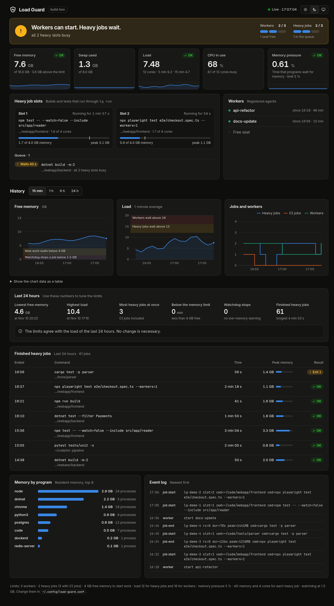
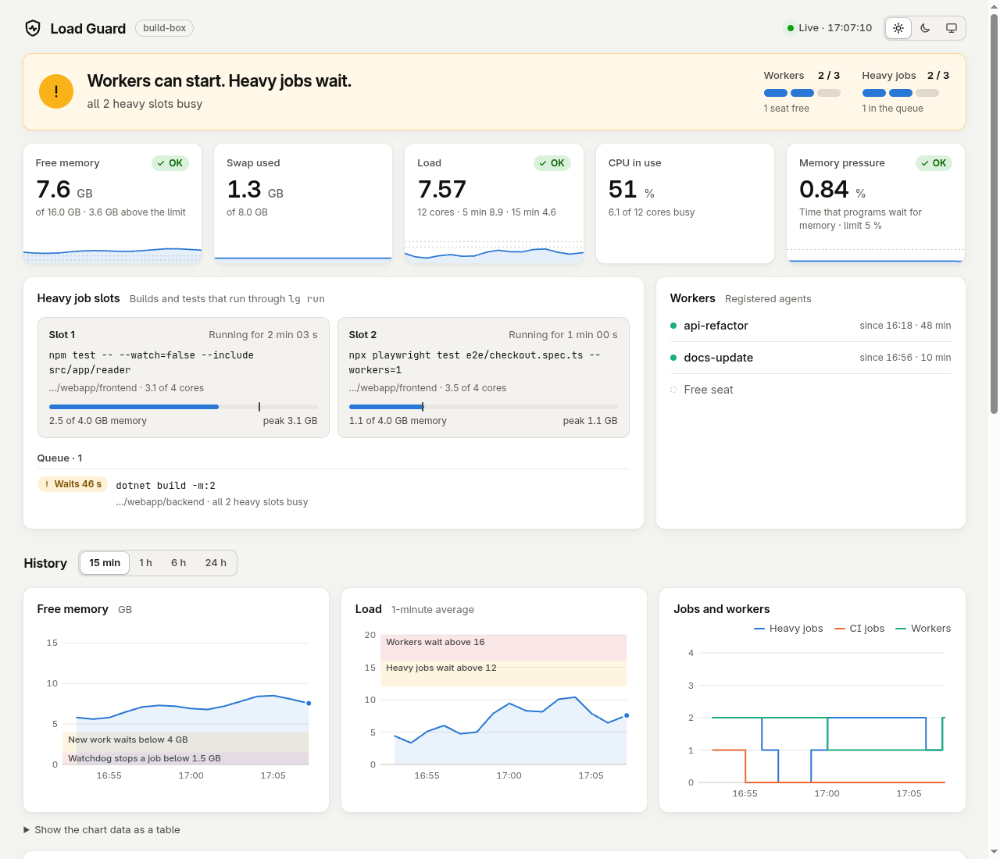

# load guard

**Run many coding agents on one Linux machine without running it out of memory.**

When several AI agents (Claude Code subagents, OpenCode, Codex, CI jobs…) work on the same machine, each one tends to start its own full build or test suite. Two or three of those at once can push the machine into swap or the out-of-memory killer, and then everything on it slows down or dies.

load guard is a small Bash tool, `lg`, plus an optional live dashboard:

- **Admission gate for workers** – `lg admit` says `ADMIT` or `WAIT: <reasons>` before an orchestrator starts another agent.
- **Slots and hard limits for heavy commands** – `lg run -- npm test` waits for a free machine-wide slot and enough free memory, then runs the command in its own systemd scope with a memory limit, a swap limit, a CPU quota and a lower priority.
- **Memory watchdog** – when free memory gets critically low, it stops the newest `lg run` job (only those) and tells the caller to retry later (exit code 75).
- **Live dashboard** – one page that shows if there is room for more work, what runs now, what waits and why, and how the last 24 hours went.
- **Agent skill** – `SKILL.md` teaches the agent to use all of this when it fans out work (Claude Code, and other harnesses that read the [Agent Skills](https://agentskills.io) format; see [Other agent harnesses](#other-agent-harnesses)).

Everything is per user, shared by all sessions of that user on the machine, so the limits hold across terminals and agents. No root, no daemon besides two small user services, no dependencies outside a standard Linux install.



<details>
<summary>Light mode</summary>


</details>

## Requirements

- Linux with **systemd** (user services) and **cgroup v2**: any current Ubuntu, Debian, Fedora, Arch, or WSL2 with systemd turned on
- Bash 4+, Python 3.8+, `flock`, `pgrep` (all in a normal install)
- For the per-job memory limit, the memory controller must be delegated to user services. This is the default on current systemd versions; check with
  `cat /sys/fs/cgroup/user.slice/user-$(id -u).slice/user@$(id -u).service/cgroup.subtree_control` (it should list `memory`).

## Install

As a Claude Code skill (other harnesses: see [below](#other-agent-harnesses)):

```bash
git clone https://github.com/Christian-Gennari/load-guard ~/.claude/skills/load-guard
~/.claude/skills/load-guard/install.sh
```

Without Claude Code, clone it anywhere and run `./install.sh` in it.

The installer checks the requirements, links `lg` into `~/.local/bin`, creates `~/.config/load-guard.conf` (all lines commented, so the defaults apply), and starts two user services: the watchdog and the dashboard on <http://127.0.0.1:8377/>.

| Option | Effect |
|---|---|
| `--tailscale` | Also publish the dashboard to your tailnet over HTTPS with `tailscale serve` (not to the public internet). |
| `--no-dashboard` | Install the watchdog only. |
| `--no-services` | Only put `lg` on PATH. |
| `--uninstall` | Stop and remove the services and the PATH link. |

User services stop when you log out. On a server, run `sudo loginctl enable-linger $USER` once so they keep running.

To update: `git -C ~/.claude/skills/load-guard pull`, then `systemctl --user restart load-guard-watchdog load-guard-dashboard`.

**Try the dashboard first, without installing:** `python3 dashboard/server.py --demo` and open <http://127.0.0.1:8377/>. It shows synthetic data.

## Use

```bash
lg status                          # free memory, load, jobs, workers, ADMIT/WAIT
lg run -- npm test                 # run a heavy command inside the limits (waits for a slot)
lg run --mem 6G -- cargo build     # with a larger memory limit for this job
lg admit && start-another-agent    # gate for a new worker
lg worker start api-refactor       # register a worker …
lg worker end api-refactor         # … and remove it when it is done
lg report 24                       # numbers to tune the limits
lg dashboard --url                 # where the dashboard is
```

Exit code **75** from `lg run` means the job was stopped by the watchdog, or waited too long in the queue: wait a moment and run it again.

In Claude Code, say "use the load guard" or just start parallel work: the skill tells Claude to check `lg admit` before each new worker, to register workers, and to give every worker a short brief that makes it run builds and tests through `lg run`.

## Other agent harnesses

`lg` and the dashboard do not depend on Claude Code. Any agent that can run a shell command can use them, and the limits are the same for all of them: Claude Code, Codex, OpenCode, Cursor, Gemini CLI or your own scripts can share one machine.

`SKILL.md` follows the open [Agent Skills](https://agentskills.io) format, which several harnesses read. Each harness looks in its own skills folder (for example `~/.claude/skills/`, `~/.codex/skills/`, `~/.agents/skills/` or `.cursor/skills/`; check the documentation of your tool). Keep one clone and link it into the folder your harness reads:

```bash
mkdir -p ~/.agents/skills && ln -s ~/.claude/skills/load-guard ~/.agents/skills/load-guard
```

For a harness without skills, add the rules to its instructions file (for example `AGENTS.md`):

```markdown
## Machine load
This machine is shared with other agents. Run every build, test or Playwright command as
`lg run -- <command>`. If it prints "queued", wait. Exit code 75 means it was stopped for low
memory: wait 2 minutes and run it again. Before you start parallel workers, run `lg admit`
and start a worker only on ADMIT. Run the narrowest test target; never leave watchers running.
```

## Configuration

Defaults are calculated from the machine (memory and core count). On a 16 GB, 12-core machine: 3 workers, 2 heavy jobs, 4 GB free memory to start work, 4 GB memory and 4 cores per heavy job, watchdog at 1.5 GB free. Run `lg config` to see yours.

Change them in `~/.config/load-guard.conf`; [`config.example.conf`](config.example.conf) lists every key. Two worth knowing:

```bash
# Let only one full test suite run at a time, but allow filtered runs in parallel:
LG_EXCLUSIVE_MATCH='*dotnet test*'
LG_EXCLUSIVE_UNLESS='*--filter*'

# CI jobs on this machine count as heavy jobs (GitHub Actions self-hosted runners by default):
LG_CI_PROCESS=Runner.Worker
```

The dashboard's "Last 24 hours" panel tells you when the limits are too tight or too loose. You can keep notes about your machine (measured peak memory of your test suites, other services) in `~/.config/load-guard.notes.md`; the Claude Code skill reads that file first.

## Dashboard

The dashboard (`dashboard/server.py`, Python standard library only, about 12 MB of memory) pushes a new sample to the browser every 2 seconds over Server-Sent Events. It takes samples only while a browser is connected, so it costs nothing when nobody looks.

It shows a verdict ("Room for more work", or the reasons new work waits), memory, swap, load, CPU and memory pressure with 15-minute trends, each running job with its live memory against its limit, the queue, history charts with the limit zones and watchdog stops, a 24-hour summary with tuning advice, finished jobs with duration and peak memory, memory by program, and the event log. Dark mode is the default; there is a light / dark / system switch.

The page has **no login**. It listens on `127.0.0.1` by default; use `--tailscale` (or your own reverse proxy with authentication) to reach it from other devices. JSON endpoints: `/api/status`, `/api/history?hours=N`, `/api/recent?hours=N`.

## How it works

- State lives in `~/.cache/load-guard/`: one file per running job, worker and queued command, `flock` locks for the slots, an event log and a one-line-per-minute metrics log written by the watchdog.
- `lg run` takes a slot lock, then starts the command with `systemd-run --user --scope` and the properties `MemoryMax`, `MemorySwapMax`, `CPUQuota` and `--nice`. When the job ends, it logs the duration and the cgroup's peak memory.
- The checks use `MemAvailable` from `/proc/meminfo`, the 1-minute load average, and memory pressure (PSI) from `/proc/pressure/memory`.
- Only commands that go through `lg run` get hard limits. Everything else depends on the agents following the brief in `SKILL.md`.

## License

MIT, see [LICENSE](LICENSE). The bundled fonts are under the SIL Open Font License 1.1: [Inter](dashboard/fonts/LICENSE-Inter.txt) and [JetBrains Mono](dashboard/fonts/LICENSE-JetBrainsMono.txt).
